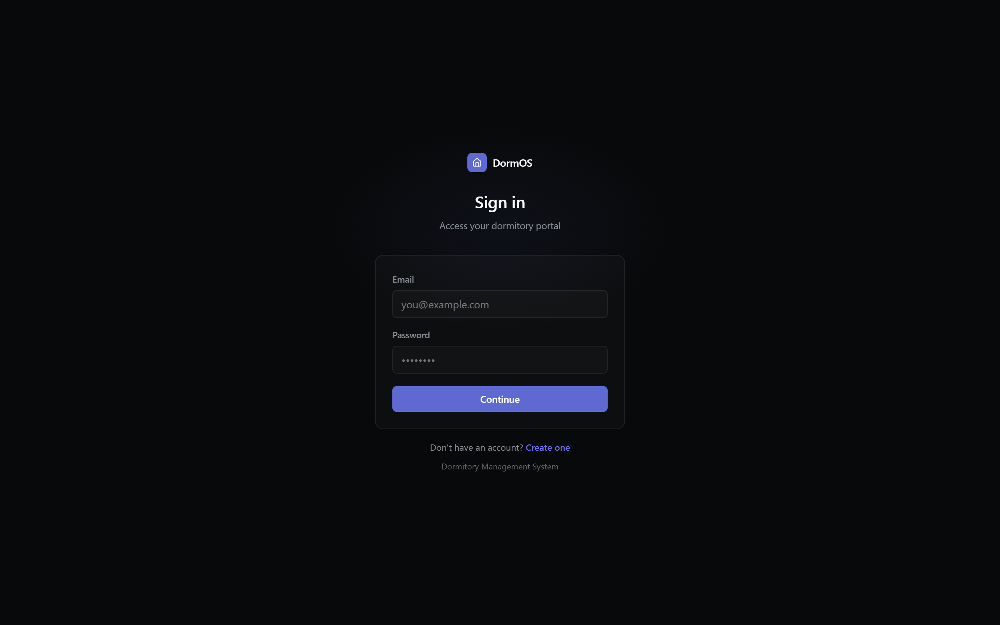
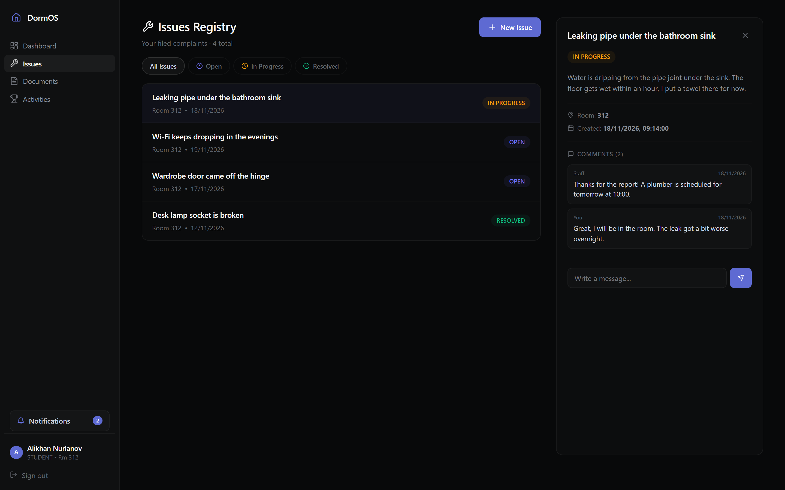
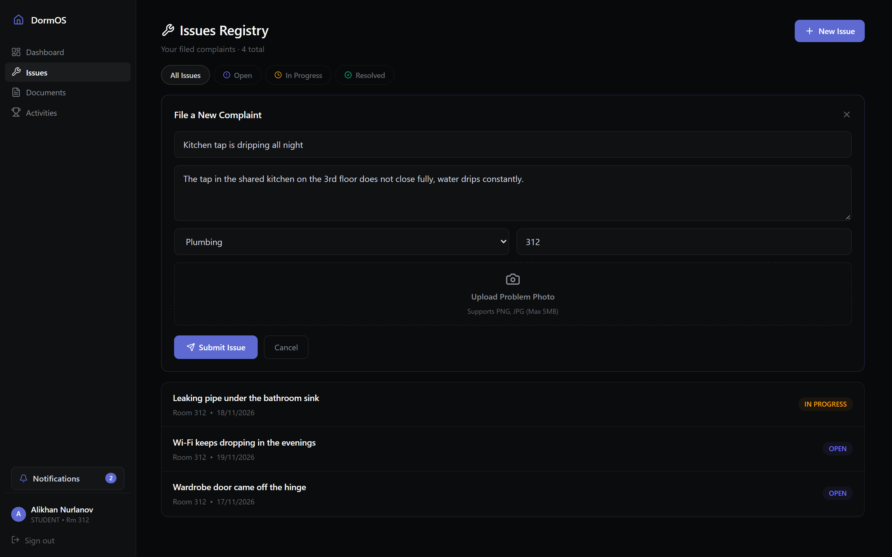
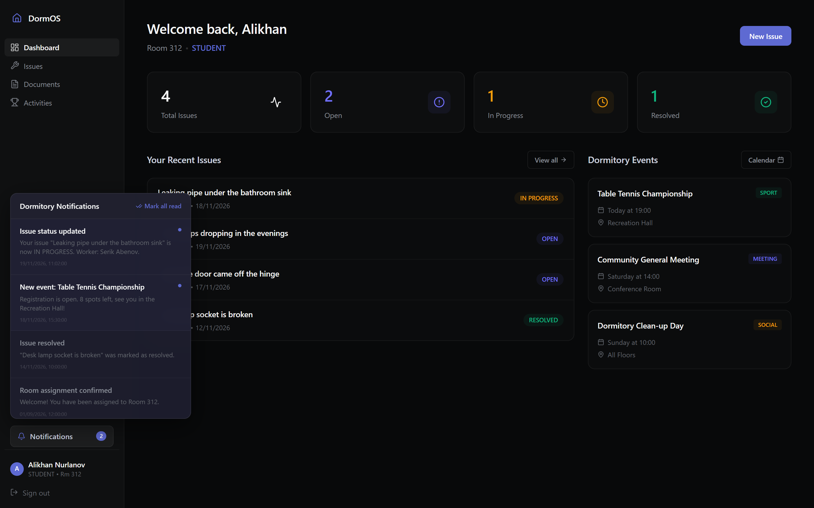
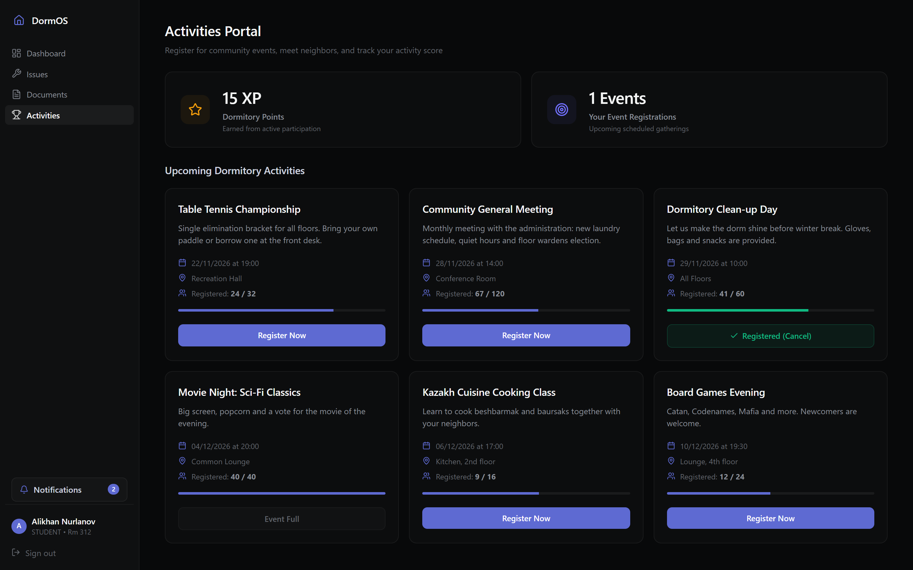
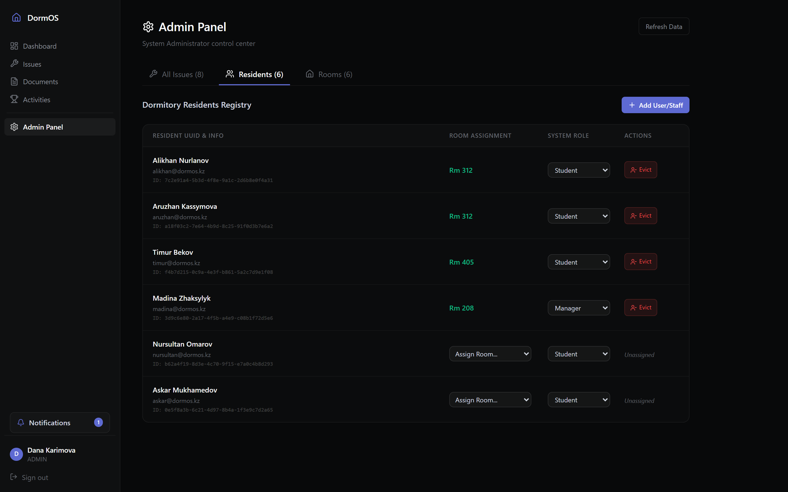
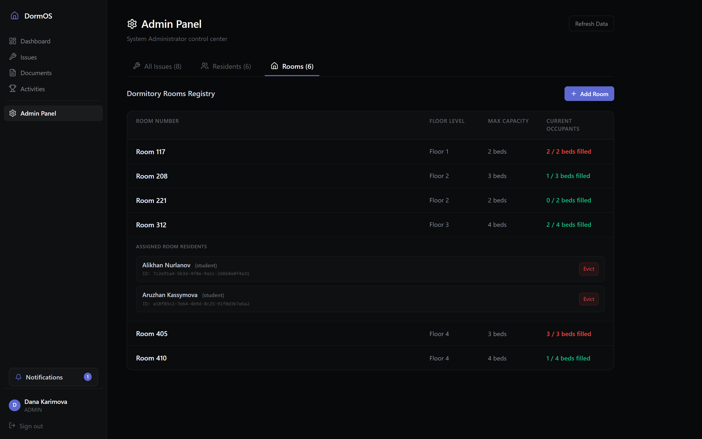
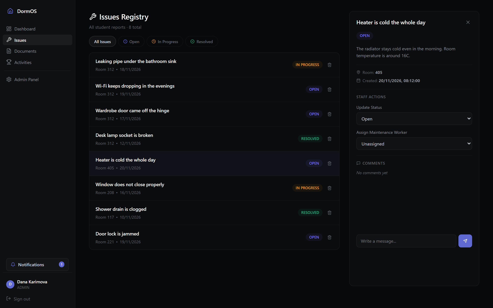
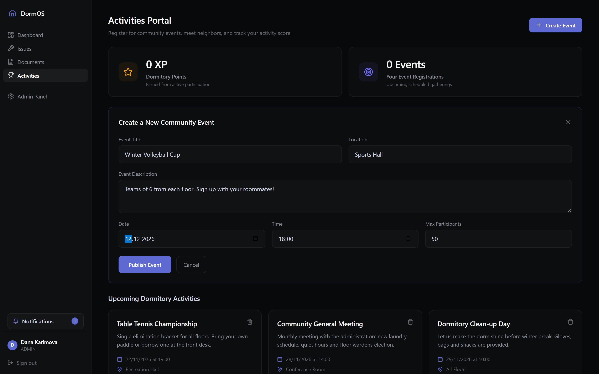
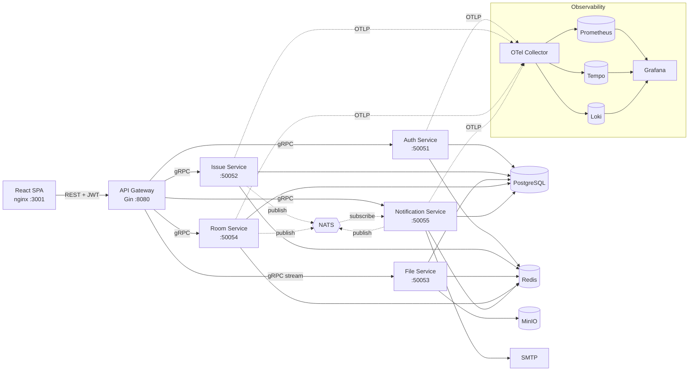

<div align="center">

# DormOS

**A dormitory management platform for student housing**

Maintenance requests, room assignments, community events and notifications in one place.
Go microservices talking over gRPC and NATS, with a React web client.


<sub>A student signs in, replies in a maintenance request, registers for an event and checks notifications. Then an administrator opens the control panel.</sub>

</div>

---

## Table of Contents

- [Features](#features)
- [Screenshots](#screenshots)
- [Architecture](#architecture)
- [Tech Stack](#tech-stack)
- [Repository Structure](#repository-structure)
- [Getting Started](#getting-started)
- [REST API](#rest-api)
- [Observability](#observability)
- [Tests](#tests)

## Features

DormOS has three roles: **student**, **manager** and **admin**. The interface and the available actions depend on the user's role.

### Student

- Sign up and sign in with email and password, JWT access and refresh tokens.
- Dashboard with stats on your own requests and upcoming dormitory events.
- File a maintenance request: title, description, category, room number and a photo of the problem (the file is stored in MinIO via the File Service).
- Discuss a request with staff in its comment thread.
- Register for events or cancel a registration, earn activity points for participating.
- Notification center: request status changes, new events, room assignment, role changes.
- Requests can only be filed after the student is assigned to a room, until then the interface shows a hint.

### Manager

- All dormitory requests with a status filter.
- Change request status (`open`, `in_progress`, `resolved`, `closed`) and assign a maintenance worker.

### Admin

- Everything a manager can do, plus deleting requests.
- Residents registry: assign to a room, evict, change role, create users and staff accounts.
- Rooms registry: create rooms, see floor, capacity, occupancy and the list of residents in each room.
- Create and delete dormitory events.

## Screenshots

> The screenshots use demo data.

### Sign in and sign up

<table>
  <tr>
    <td width="50%"></td>
    <td width="50%"></td>
  </tr>
</table>

### Student dashboard

Request stats, recent requests and upcoming events.


### Maintenance requests

<table>
  <tr>
    <td width="50%"></td>
    <td width="50%"></td>
  </tr>
  <tr>
    <td align="center"><sub>Request list and a request with its comments</sub></td>
    <td align="center"><sub>New request form with photo upload</sub></td>
  </tr>
</table>

### Notifications and events

<table>
  <tr>
    <td width="50%"></td>
    <td width="50%"></td>
  </tr>
  <tr>
    <td align="center"><sub>Notification center with unread messages</sub></td>
    <td align="center"><sub>Events, registrations and activity points</sub></td>
  </tr>
</table>

### Admin panel

All dormitory requests: status and assigned worker can be changed right in the table.


<table>
  <tr>
    <td width="50%"></td>
    <td width="50%"></td>
  </tr>
  <tr>
    <td align="center"><sub>Residents: room assignment, eviction and roles</sub></td>
    <td align="center"><sub>Rooms: occupancy and list of residents</sub></td>
  </tr>
  <tr>
    <td width="50%"></td>
    <td width="50%"></td>
  </tr>
  <tr>
    <td align="center"><sub>Request details for staff: status and worker</sub></td>
    <td align="center"><sub>Creating a new event</sub></td>
  </tr>
</table>

## Architecture

The frontend talks only to the API Gateway over REST. The gateway validates the JWT and calls the right service over gRPC. Services publish domain events to NATS, and the Notification Service turns them into notifications for users.



### Services

| Service | Port | Responsibility |
| --- | --- | --- |
| **API Gateway** | `8080` | Single REST entry point, JWT validation, CORS, translating requests to gRPC |
| **Auth Service** | `50051` | Sign up, sign in, access and refresh tokens, sessions, user profile |
| **Issue Service** | `50052` | Requests, categories, comments, workers and request statuses |
| **File Service** | `50053` | Streaming file uploads to MinIO over gRPC, presigned URLs |
| **Room Service** | `50054` | Rooms, check-in and eviction, resident roles, stats |
| **Notification Service** | `50055` | Dormitory events and registrations, in-app and email notifications |
| **Frontend** | `3001` | React SPA behind nginx, proxies `/api` to the API Gateway |

Each service is split into `transport` (gRPC, NATS), `usecase`, `repository` and `domain` layers and keeps its own SQL migrations in a `migrations` folder. All services share one PostgreSQL database, but each owns its tables and its own migrations history table. gRPC contracts are defined in Protobuf, and the generated Go code comes from the `github.com/Garryflop/DormOS-gen-go` module.

### NATS events

| Subject | Published by |
| --- | --- |
| `issue.created` | Issue Service |
| `issue.status_changed` | Issue Service |
| `resident.assigned` | Room Service |
| `resident.removed` | Room Service |
| `role.updated` | Room Service |
| `event.created` | Notification Service |
| `event.cancelled` | Notification Service |

The Notification Service subscribes to all of these subjects and creates notifications for the relevant users.

## Tech Stack

| Layer | Technologies |
| --- | --- |
| Backend | Go 1.25, Go workspaces, gRPC, Protocol Buffers (buf), Gin, pgx, golang-migrate, JWT |
| Messaging | NATS with JetStream |
| Storage | PostgreSQL 15, Redis 7, MinIO (S3 compatible file storage) |
| Frontend | React 19, TypeScript, Vite, React Router 7, TanStack Query, Axios, Tailwind CSS 4, lucide-react |
| Observability | OpenTelemetry Collector, Prometheus, Tempo, Loki, Grafana |
| Testing | testify, testcontainers-go |
| Infrastructure | Docker, Docker Compose, nginx |

## Repository Structure

```text
.
├── api-gateway/            REST API on Gin: handlers, JWT and CORS middleware
├── auth-service/           authentication, tokens, sessions
├── issue-service/          requests, comments, categories, workers
├── room-service/           rooms, residents, roles
├── file-service/           file uploads to MinIO
├── notification-service/   dormitory events and notifications
├── pkg/                    shared code: config, database, grpcutil, nats, redis
├── frontend/               React + Vite client
├── docs/                   screenshots and demo for this README
├── grafana/                Grafana configuration
├── docker-compose.yml      the whole stack in one command
├── Dockerfile              shared multi-stage image for Go services
├── go.work                 Go workspace for all modules
├── otel-collector-config.yaml, prometheus.yml, tempo.yaml
└── *.postman_collection.json   Postman request collections
```

Inside every Go service:

```text
<service>/
├── cmd/main.go             entry point
├── internal/
│   ├── config/             configuration and OpenTelemetry
│   ├── domain/             entities and interfaces
│   ├── repository/         PostgreSQL access
│   ├── usecase/            business logic
│   └── transport/          gRPC handlers and NATS
└── migrations/             SQL migrations
```

## Getting Started

### Prerequisites

- Docker with Docker Compose v2
- Go 1.25 or newer (needed to prepare `vendor`)
- Node.js 20 or newer (only for local frontend development)

### Run the whole stack

```bash
git clone https://github.com/Garryflop/DormOS.git
cd DormOS

# Docker images are built offline from the shared vendor folder
go work vendor

docker compose up -d --build
```

Migrations are applied automatically by dedicated `*-migrate` containers before the services start. Defaults (PostgreSQL, Redis and MinIO passwords, JWT secret) are set in `docker-compose.yml` and can be overridden in `.env`, see `.env.example`.

Once the stack is up:

| URL | What it is |
| --- | --- |
| http://localhost:3001 | DormOS web interface |
| http://localhost:8080/health | API Gateway health check |
| http://localhost:3000 | Grafana |
| http://localhost:9090 | Prometheus |
| http://localhost:9001 | MinIO console (`admin` / `admin123`) |
| http://localhost:8222 | NATS monitoring |

There is also a `Makefile`:

```bash
make up      # docker-compose up -d
make down    # stop the containers
make clean   # stop and remove volumes
```

### First administrator

Signing up through the interface creates a user with the `student` role. To grant yourself admin rights, run:

```bash
docker compose exec postgres psql -U dormos -d dormos \
  -c "UPDATE users SET role = 'admin' WHERE email = 'you@example.com';"
```

Then sign in again. Other roles and room assignments are managed from the **Admin Panel**.

### Local frontend development

```bash
cd frontend
npm install
npm run dev
```

Vite starts on http://localhost:5173 and calls the API at `VITE_API_URL` (defaults to `http://localhost:8080/api/v1`).

## REST API

Base path: `/api/v1`. Every request except sign up, sign in and token refresh requires an `Authorization: Bearer <access_token>` header. Ready-made request collections are in the repository root: `DormOS.postman_collection.json` and `DormOS_Student_Scope.postman_collection.json`.

<details>
<summary><b>Endpoint list</b></summary>

#### Auth

| Method | Path | Description |
| --- | --- | --- |
| `POST` | `/auth/register` | Sign up |
| `POST` | `/auth/login` | Sign in, returns access and refresh tokens |
| `POST` | `/auth/refresh` | Refresh the access token |
| `GET` | `/auth/profile` | Current user profile |
| `POST` | `/auth/logout` | Sign out and revoke the session |
| `POST` | `/auth/validate` | Validate a token |

#### Requests

| Method | Path | Description |
| --- | --- | --- |
| `POST` | `/issues` | Create a request |
| `GET` | `/issues/my` | My requests |
| `GET` | `/issues` | All requests (staff) |
| `GET` | `/issues/:id` | Request by id |
| `PATCH` | `/issues/:id/status` | Change status |
| `PATCH` | `/issues/:id/assign` | Assign a worker |
| `DELETE` | `/issues/:id` | Delete a request |
| `GET` | `/issues/:id/comments` | Request comments |
| `POST` | `/issues/:id/comments` | Add a comment |
| `GET` | `/issues/workers` | List workers |
| `GET` | `/categories` | Request categories |
| `POST` | `/issues/categories` | Create a category |

#### Rooms and residents

| Method | Path | Description |
| --- | --- | --- |
| `GET` | `/rooms` | List rooms (filter `?floor=`) |
| `POST` | `/rooms` | Create a room |
| `GET` | `/rooms/:id` | Room by id |
| `GET` | `/residents` | List residents (filter `?role=`) |
| `POST` | `/residents` | Assign a resident to a room |
| `GET` | `/residents/:user_id` | Resident by user id |
| `DELETE` | `/residents/:user_id` | Evict a resident |
| `PATCH` | `/residents/:user_id/role` | Change role |
| `GET` | `/dashboard/stats` | Room and resident stats |

#### Files

| Method | Path | Description |
| --- | --- | --- |
| `POST` | `/files/upload` | Upload a file (`multipart/form-data`) |
| `GET` | `/files/:id/url` | Get a file URL |
| `DELETE` | `/files/:id` | Delete a file |

#### Events

| Method | Path | Description |
| --- | --- | --- |
| `GET` | `/events` | List events |
| `POST` | `/events` | Create an event |
| `PUT` | `/events/:id` | Update an event |
| `DELETE` | `/events/:id` | Delete an event |
| `POST` | `/events/:id/register` | Register for an event |
| `POST` | `/events/:id/cancel` | Cancel a registration |

#### Notifications

| Method | Path | Description |
| --- | --- | --- |
| `GET` | `/notifications` | User notifications |
| `POST` | `/notifications` | Send a notification |
| `PATCH` | `/notifications/:id/read` | Mark as read |
| `POST` | `/notifications/read-all` | Mark all as read |

</details>

## Observability

Services send traces and metrics over OTLP to the OpenTelemetry Collector (`4317` gRPC, `4318` HTTP). The collector routes the data:

- **traces** go to Tempo,
- **metrics** are exposed on `:8889` and scraped by Prometheus,
- **logs** are shipped to Loki.

Everything can be explored in Grafana at http://localhost:3000, anonymous access is enabled.

## Tests

Tests live next to the code of each service:

- unit tests for business logic (`usecase`) in the auth, issue, room and notification services;
- gRPC handler tests in the room and file services;
- repository integration tests in the issue and file services built on testcontainers, they need a running Docker.

```bash
cd room-service
go test ./...
```
