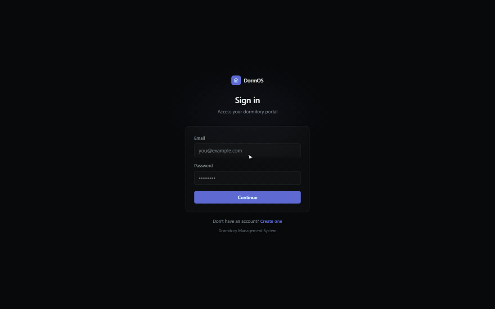
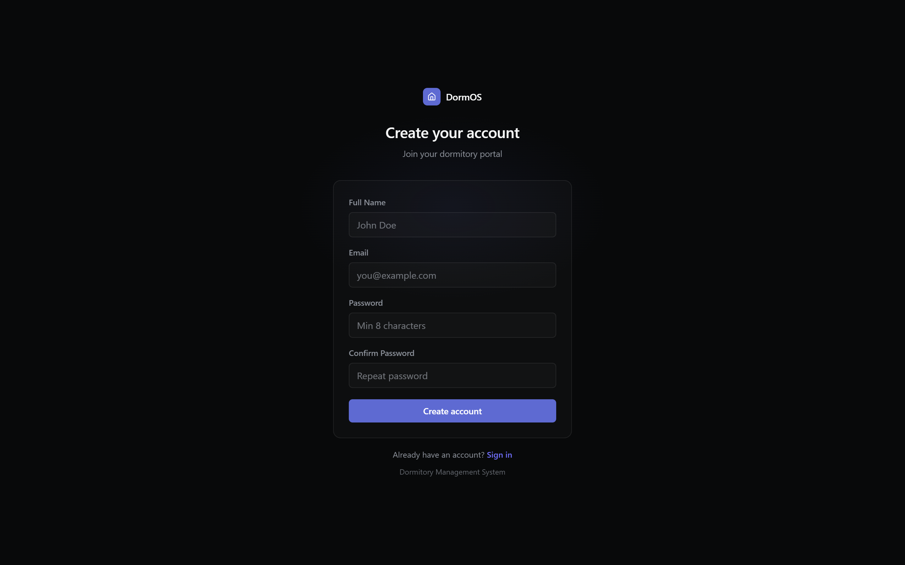
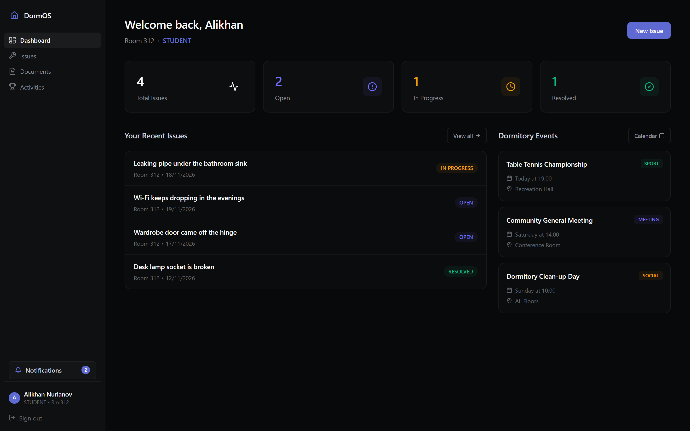
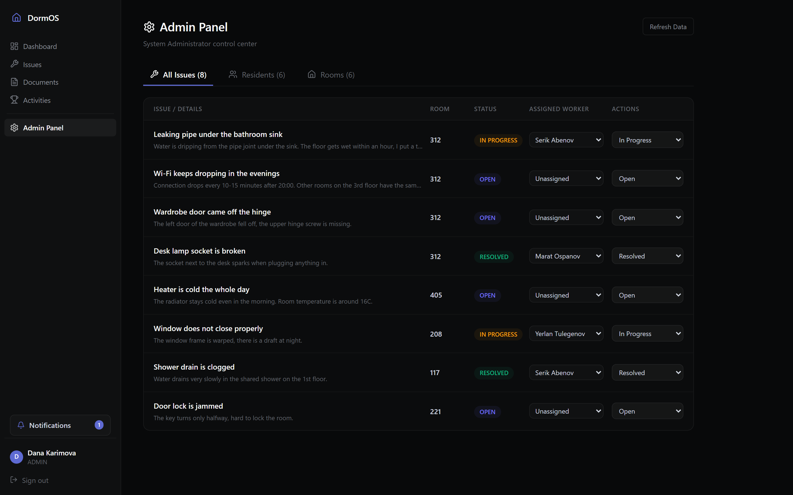
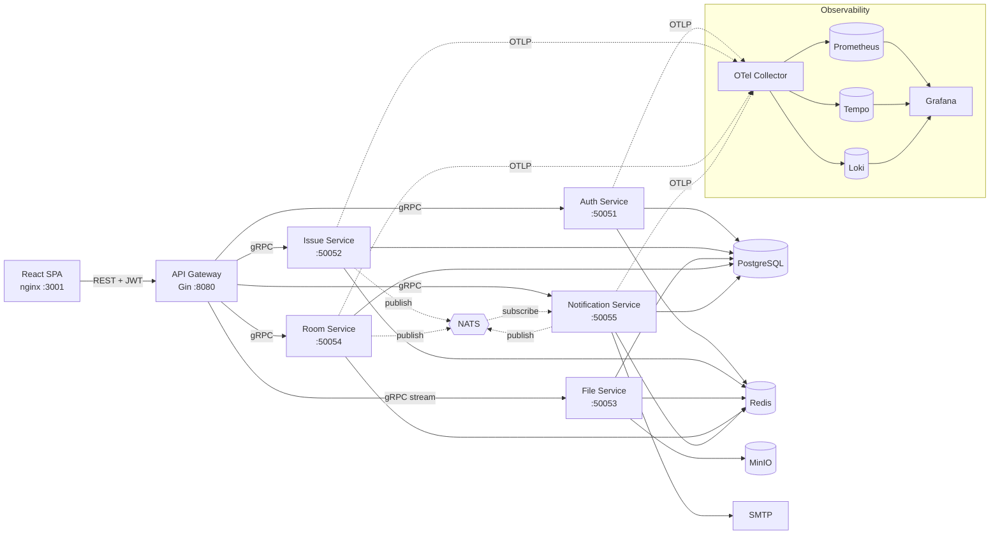

<div align="center">

# DormOS

**Платформа для управления студенческим общежитием**

Заявки на ремонт, заселение по комнатам, события для жильцов и уведомления в одном интерфейсе.
Микросервисы на Go, связь по gRPC и NATS, веб-клиент на React.




<sub>Студент входит в систему, отвечает в заявке на ремонт, записывается на событие и читает уведомления. Затем администратор открывает панель управления.</sub>

</div>

---

## Содержание

- [Возможности](#возможности)
- [Скриншоты](#скриншоты)
- [Архитектура](#архитектура)
- [Технологии](#технологии)
- [Структура репозитория](#структура-репозитория)
- [Быстрый старт](#быстрый-старт)
- [REST API](#rest-api)
- [Наблюдаемость](#наблюдаемость)
- [Тесты](#тесты)

## Возможности

В системе три роли: **student**, **manager** и **admin**. Интерфейс и доступные действия зависят от роли пользователя.

### Студент

- Регистрация и вход по email и паролю, JWT access и refresh токены.
- Дашборд со статистикой своих заявок и ближайшими событиями общежития.
- Подача заявки на ремонт: заголовок, описание, категория, номер комнаты и фото проблемы (файл уходит в MinIO через File Service).
- Переписка с персоналом в комментариях к заявке.
- Запись на события и отмена записи, очки активности за участие.
- Центр уведомлений: смена статуса заявки, новые события, заселение в комнату, смена роли.
- Подать заявку можно только после заселения в комнату, до этого интерфейс показывает подсказку.

### Менеджер

- Все заявки общежития с фильтром по статусу.
- Смена статуса заявки (`open`, `in_progress`, `resolved`, `closed`) и назначение мастера.

### Администратор

- Всё, что доступно менеджеру, плюс удаление заявок.
- Реестр жильцов: заселение в комнату, выселение, смена роли, создание пользователей и сотрудников.
- Реестр комнат: создание комнат, этаж, вместимость, заполненность и список жильцов каждой комнаты.
- Создание и удаление событий общежития.

## Скриншоты

> На скриншотах демонстрационные данные.

### Вход и регистрация

<table>
  <tr>
    <td width="50%"></td>
    <td width="50%"></td>
  </tr>
</table>

### Дашборд студента

Статистика по заявкам, последние обращения и ближайшие события.



### Заявки на ремонт

<table>
  <tr>
    <td width="50%"></td>
    <td width="50%"></td>
  </tr>
  <tr>
    <td align="center"><sub>Список заявок и карточка с комментариями</sub></td>
    <td align="center"><sub>Форма новой заявки с загрузкой фото</sub></td>
  </tr>
</table>

### Уведомления и события

<table>
  <tr>
    <td width="50%"></td>
    <td width="50%"></td>
  </tr>
  <tr>
    <td align="center"><sub>Центр уведомлений с непрочитанными сообщениями</sub></td>
    <td align="center"><sub>События, запись на них и очки активности</sub></td>
  </tr>
</table>

### Панель администратора

Все заявки общежития: статус и назначенный мастер меняются прямо в таблице.



<table>
  <tr>
    <td width="50%"></td>
    <td width="50%"></td>
  </tr>
  <tr>
    <td align="center"><sub>Жильцы: заселение, выселение и роли</sub></td>
    <td align="center"><sub>Комнаты: заполненность и список жильцов</sub></td>
  </tr>
  <tr>
    <td width="50%"></td>
    <td width="50%"></td>
  </tr>
  <tr>
    <td align="center"><sub>Карточка заявки для персонала: статус и мастер</sub></td>
    <td align="center"><sub>Создание нового события</sub></td>
  </tr>
</table>

## Архитектура

Фронтенд общается только с API Gateway по REST. Gateway проверяет JWT и вызывает нужный сервис по gRPC. Сервисы публикуют доменные события в NATS, а Notification Service превращает их в уведомления для пользователей.



### Сервисы

| Сервис | Порт | Зона ответственности |
| --- | --- | --- |
| **API Gateway** | `8080` | Единая REST точка входа, проверка JWT, CORS, трансляция запросов в gRPC |
| **Auth Service** | `50051` | Регистрация, вход, access и refresh токены, сессии, профиль пользователя |
| **Issue Service** | `50052` | Заявки, категории, комментарии, мастера и статусы заявок |
| **File Service** | `50053` | Загрузка файлов в MinIO потоком по gRPC, выдача presigned ссылок |
| **Room Service** | `50054` | Комнаты, заселение и выселение, роли жильцов, статистика |
| **Notification Service** | `50055` | События общежития и запись на них, уведомления в приложении и по email |
| **Frontend** | `3001` | React SPA за nginx, проксирует `/api` в API Gateway |

Каждый сервис построен по слоям `transport` (gRPC, NATS), `usecase`, `repository`, `domain` и хранит свои SQL миграции в папке `migrations`. Все сервисы работают с одной базой PostgreSQL, но у каждого свои таблицы и своя таблица истории миграций. Контракты gRPC описаны в Protobuf, сгенерированный Go код подключается модулем `github.com/Garryflop/DormOS-gen-go`.

### События NATS

| Тема | Источник |
| --- | --- |
| `issue.created` | Issue Service |
| `issue.status_changed` | Issue Service |
| `resident.assigned` | Room Service |
| `resident.removed` | Room Service |
| `role.updated` | Room Service |
| `event.created` | Notification Service |
| `event.cancelled` | Notification Service |

Notification Service подписан на все эти темы и создаёт уведомления для нужных пользователей.

## Технологии

| Слой | Стек |
| --- | --- |
| Backend | Go 1.25, Go workspaces, gRPC, Protocol Buffers (buf), Gin, pgx, golang-migrate, JWT |
| Обмен сообщениями | NATS с JetStream |
| Хранилища | PostgreSQL 15, Redis 7, MinIO (S3 совместимое хранилище файлов) |
| Frontend | React 19, TypeScript, Vite, React Router 7, TanStack Query, Axios, Tailwind CSS 4, lucide-react |
| Наблюдаемость | OpenTelemetry Collector, Prometheus, Tempo, Loki, Grafana |
| Тесты | testify, testcontainers-go |
| Инфраструктура | Docker, Docker Compose, nginx |

## Структура репозитория

```text
.
├── api-gateway/            REST API на Gin: хендлеры, JWT и CORS middleware
├── auth-service/           аутентификация, токены, сессии
├── issue-service/          заявки, комментарии, категории, мастера
├── room-service/           комнаты, жильцы, роли
├── file-service/           загрузка файлов в MinIO
├── notification-service/   события общежития и уведомления
├── pkg/                    общий код: config, database, grpcutil, nats, redis
├── frontend/               React + Vite клиент
├── docs/                   скриншоты и демо для README
├── grafana/                конфигурация Grafana
├── docker-compose.yml      весь стек одной командой
├── Dockerfile              общий multi-stage образ для Go сервисов
├── go.work                 Go workspace для всех модулей
├── otel-collector-config.yaml, prometheus.yml, tempo.yaml
└── *.postman_collection.json   коллекции запросов для Postman
```

Внутри каждого Go сервиса:

```text
<service>/
├── cmd/main.go             точка входа
├── internal/
│   ├── config/             конфигурация и OpenTelemetry
│   ├── domain/             сущности и интерфейсы
│   ├── repository/         работа с PostgreSQL
│   ├── usecase/            бизнес-логика
│   └── transport/          gRPC хендлеры и NATS
└── migrations/             SQL миграции
```

## Быстрый старт

### Требования

- Docker и Docker Compose v2
- Go 1.25 или новее (нужен для подготовки `vendor`)
- Node.js 20 или новее (только для локальной разработки фронтенда)

### Запуск всего стека

```bash
git clone https://github.com/Garryflop/DormOS.git
cd DormOS

# Docker образы собираются офлайн из общей папки vendor
go work vendor

docker compose up -d --build
```

Миграции применяются автоматически отдельными контейнерами `*-migrate` до старта сервисов. Значения по умолчанию (пароли PostgreSQL, Redis, MinIO, JWT секрет) заданы в `docker-compose.yml`, их можно переопределить через `.env`, пример лежит в `.env.example`.

После запуска доступны:

| Адрес | Что это |
| --- | --- |
| http://localhost:3001 | Веб-интерфейс DormOS |
| http://localhost:8080/health | Health check API Gateway |
| http://localhost:3000 | Grafana |
| http://localhost:9090 | Prometheus |
| http://localhost:9001 | Консоль MinIO (`admin` / `admin123`) |
| http://localhost:8222 | Мониторинг NATS |

Для удобства есть `Makefile`:

```bash
make up      # docker-compose up -d
make down    # остановить контейнеры
make clean   # остановить и удалить volumes
```

### Первый администратор

Регистрация через интерфейс создаёт пользователя с ролью `student`. Чтобы выдать себе права администратора, выполни:

```bash
docker compose exec postgres psql -U dormos -d dormos \
  -c "UPDATE users SET role = 'admin' WHERE email = 'you@example.com';"
```

После этого войди в систему заново. Остальные роли и заселение по комнатам настраиваются уже в **Admin Panel**.

### Локальная разработка фронтенда

```bash
cd frontend
npm install
npm run dev
```

Vite поднимется на http://localhost:5173 и будет ходить в API по адресу из `VITE_API_URL` (по умолчанию `http://localhost:8080/api/v1`).

## REST API

Базовый путь: `/api/v1`. Все запросы, кроме регистрации, входа и обновления токена, требуют заголовок `Authorization: Bearer <access_token>`. Готовые коллекции запросов лежат в корне репозитория: `DormOS.postman_collection.json` и `DormOS_Student_Scope.postman_collection.json`.

<details>
<summary><b>Список эндпоинтов</b></summary>

#### Аутентификация

| Метод | Путь | Описание |
| --- | --- | --- |
| `POST` | `/auth/register` | Регистрация |
| `POST` | `/auth/login` | Вход, выдача access и refresh токенов |
| `POST` | `/auth/refresh` | Обновление access токена |
| `GET` | `/auth/profile` | Профиль текущего пользователя |
| `POST` | `/auth/logout` | Выход и отзыв сессии |
| `POST` | `/auth/validate` | Проверка токена |

#### Заявки

| Метод | Путь | Описание |
| --- | --- | --- |
| `POST` | `/issues` | Создать заявку |
| `GET` | `/issues/my` | Мои заявки |
| `GET` | `/issues` | Все заявки (персонал) |
| `GET` | `/issues/:id` | Заявка по id |
| `PATCH` | `/issues/:id/status` | Сменить статус |
| `PATCH` | `/issues/:id/assign` | Назначить мастера |
| `DELETE` | `/issues/:id` | Удалить заявку |
| `GET` | `/issues/:id/comments` | Комментарии к заявке |
| `POST` | `/issues/:id/comments` | Добавить комментарий |
| `GET` | `/issues/workers` | Список мастеров |
| `GET` | `/categories` | Категории заявок |
| `POST` | `/issues/categories` | Создать категорию |

#### Комнаты и жильцы

| Метод | Путь | Описание |
| --- | --- | --- |
| `GET` | `/rooms` | Список комнат (фильтр `?floor=`) |
| `POST` | `/rooms` | Создать комнату |
| `GET` | `/rooms/:id` | Комната по id |
| `GET` | `/residents` | Список жильцов (фильтр `?role=`) |
| `POST` | `/residents` | Заселить жильца в комнату |
| `GET` | `/residents/:user_id` | Жилец по id пользователя |
| `DELETE` | `/residents/:user_id` | Выселить жильца |
| `PATCH` | `/residents/:user_id/role` | Сменить роль |
| `GET` | `/dashboard/stats` | Статистика по комнатам и жильцам |

#### Файлы

| Метод | Путь | Описание |
| --- | --- | --- |
| `POST` | `/files/upload` | Загрузить файл (`multipart/form-data`) |
| `GET` | `/files/:id/url` | Получить ссылку на файл |
| `DELETE` | `/files/:id` | Удалить файл |

#### События

| Метод | Путь | Описание |
| --- | --- | --- |
| `GET` | `/events` | Список событий |
| `POST` | `/events` | Создать событие |
| `PUT` | `/events/:id` | Обновить событие |
| `DELETE` | `/events/:id` | Удалить событие |
| `POST` | `/events/:id/register` | Записаться на событие |
| `POST` | `/events/:id/cancel` | Отменить запись |

#### Уведомления

| Метод | Путь | Описание |
| --- | --- | --- |
| `GET` | `/notifications` | Уведомления пользователя |
| `POST` | `/notifications` | Отправить уведомление |
| `PATCH` | `/notifications/:id/read` | Отметить прочитанным |
| `POST` | `/notifications/read-all` | Отметить все прочитанными |

</details>

## Наблюдаемость

Сервисы отправляют трейсы и метрики по OTLP в OpenTelemetry Collector (`4317` gRPC, `4318` HTTP). Collector раскладывает данные по хранилищам:

- **трейсы** уходят в Tempo,
- **метрики** публикуются на `:8889` и собираются Prometheus,
- **логи** отправляются в Loki.

Всё это смотрится в Grafana на http://localhost:3000, анонимный доступ включён.

## Тесты

Тесты лежат рядом с кодом каждого сервиса:

- unit тесты бизнес-логики (`usecase`) в auth, issue, room и notification сервисах;
- тесты gRPC хендлеров в room и file сервисах;
- интеграционные тесты репозиториев issue и file сервисов на testcontainers, для них нужен запущенный Docker.

```bash
cd room-service
go test ./...
```
